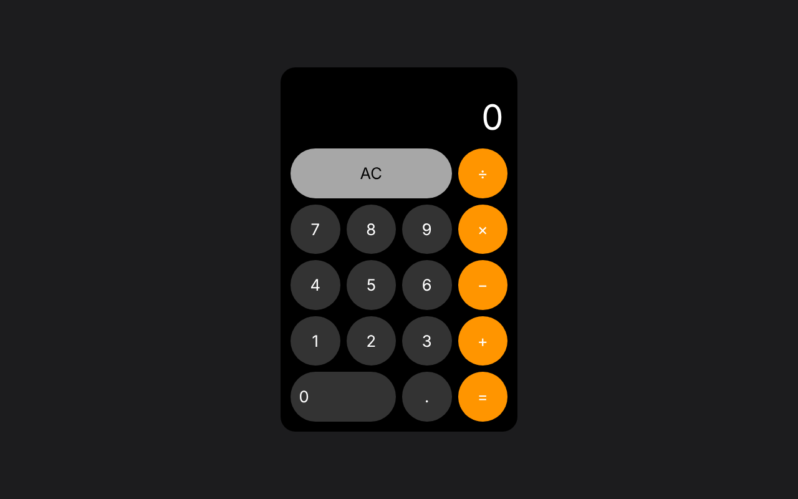
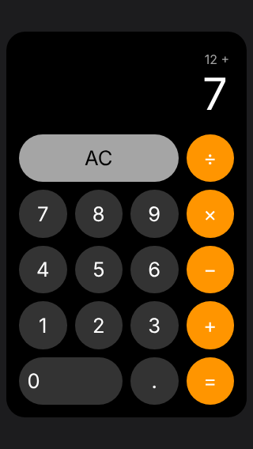

# Calculator


A basic four-function calculator (+ − × ÷) with a black / grey / orange theme. It is a single self-contained file of vanilla HTML, CSS and JavaScript: no dependencies, no build step, no network access.

<p>
  
  
</p>

Built as a "vibe coding" exercise: the requirements were written first as a spec (`spec.md`), then the app was generated, tested and reviewed against it.

## Files

| Path | What it is |
|------|------------|
| `calculator.html` | The whole app (markup, styles, logic, DOM wiring) |
| `spec.md` | The MVP spec: requirement IDs (F1-F19, U1-U7, T1-T3) and acceptance tests AT1-AT11 |
| `tests/calculator.test.js` | Logic tests (`node:test`, 42 tests) |
| `tests/browser_test.py` | Browser tests (Playwright, 35 checks): clicks, keyboard, colours, phone and desktop layout |
| `.github/workflows/tests.yml` | Runs both test suites on GitHub on every push |
| `docs/` | Screenshots used in this README |

## Open it

Double-click `calculator.html`. It opens in your default browser and works offline. You can use the on-screen keys or the keyboard: digits, `.`, `+ - * /`, `Enter` or `=` for equals, `Esc` for AC.

## Run the tests

**Logic tests** need Node.js 18 or newer (they use the built-in `node:test`; nothing to install):

```
npm test
```

This runs `node --test tests/calculator.test.js`. Pass the file path if you run it directly: `node --test tests/` (a directory) does not work on Node 22.

**Browser tests** need Python 3 and Playwright. They open the page in a headless browser, click through the acceptance tests, try the keyboard, check the colours and check the layout at 320px, 375px and desktop width:

```
pip install -r requirements-dev.txt
python -m playwright install chromium
python tests/browser_test.py
```

Screenshots are saved in `tests/screenshots/`. To use an installed Chrome instead, set `CHROME_PATH` to its location.

## Put it online (GitHub Pages)

In the repository go to **Settings → Pages**, choose **Deploy from a branch**, branch `main`, folder `/ (root)`. The calculator is then at `https://<your-username>.github.io/<repo-name>/calculator.html`.

## Code structure

`calculator.html` has two `<script>` blocks that are kept strictly separate (spec T2):

- `<script id="calc-logic">` has no DOM access. It defines the calculator state machine and exposes two functions: `createCalculator()` (methods `inputDigit`, `inputDecimal`, `inputOperator`, `equals`, `clear`, `getState`) and `formatNumber(n)`. They are exported through `module.exports` only when `module` exists, so the browser ignores that line.
- `<script id="calc-dom">` is the wiring. It runs only when `document` exists. It maps clicks and key presses to calculator calls in one `perform()` function, renders `getState()` to the page, and shrinks the display font (down to 24px) to fit long numbers.

All CSS is scoped under the `.calc` container (spec T3), apart from centring the page.

**How the tests load the logic:** `tests/calculator.test.js` reads `calculator.html`, pulls out the `calc-logic` block with a regex, and runs it in a `node:vm` sandbox that provides a `module` object. The tests therefore exercise the exact code the browser runs, with no copy to keep in sync. The same file also has a few static checks on the HTML (17 buttons, `aria-label` on each, no external URLs, theme colours present, no excluded-feature buttons).

## Key behaviour decisions

- **Immediate execution, left to right:** `2 + 3 × 4 =` gives 20 (no operator precedence).
- **12-digit entry limit:** at most 12 digits per typed number. The `.` and the sign are not counted, and extra digits are ignored.
- **12-significant-digit internal rounding:** every result is rounded to 12 significant digits to hide floating-point noise (`0.1 + 0.2` gives `0.3`, `1 ÷ 3` gives `0.333333333333`).
- **+ and − rounding by decimal places:** these results are also rounded to the larger number of decimal places among the two operands. This stops cancellation noise, e.g. `1.00000000001 − 1` gives `1e-11` rather than a noisy value.
- **Exponential display:** for |n| ≥ 1e12 or |n| < 1e-6 (or a plain form longer than 14 characters), the number is shown in scientific notation with at most 9 significant digits (e.g. `1e+24`). This changes only the display, never the stored value.
- **`5 + =` gives 10:** with an operator pending and no second number, `=` uses the first number twice.
- **Repeated `=` does nothing:** `2 + 2 = =` stays 4. After `=`, a digit starts a new calculation and an operator continues from the result.
- **Error state:** divide by zero (including `0 ÷ 0` and chained cases) shows `Error` in orange, never `Infinity` or `NaN`. Operators and `=` are ignored until AC; a digit starts a fresh calculation.
- **Consecutive operators:** the last one wins (`5 + × 2 =` gives 10). A leading operator uses 0 as the first operand.

## Excluded features (backlog)

Deliberately not built in the MVP (spec "EXCLUDED scope"), and a test checks that no such buttons exist:

- Backspace (⌫)
- ± sign toggle
- % key
- History list

Also excluded by the spec: light/dark toggle, memory keys, scientific functions, operator precedence.

## Known residuals

- **Operator colour contrast:** orange `#ff9500` with white text is about 2.1:1, below the usual 4.5:1 guideline for text. The colours come from the spec (U4), so this is pending a decision by the owner.
- **Not yet tested:** real screen readers, real touch devices, and browsers other than Chromium. Hover/press animations are only checked by eye.
- **Open review items:** pressing Enter while a button has keyboard focus gives "=" instead of pressing that button; screen-reader announcements give only the number, not the full sum.
